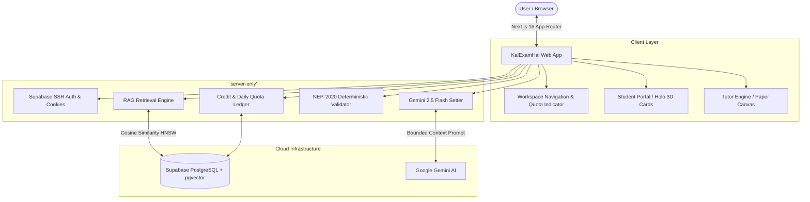

<div align="center">

# ⚡ KalExamHai (कल Exam है!) ⚡
### *The High-Fidelity AI Exam Preparation & Paper Generation Engine for Mumbai University (NEP-2020)*

<p align="center">
  <a href="https://kalexamhai.vercel.app">
    
  </a>
  
  
  
  
</p>

<p align="center">
  <strong>Engineered specifically for engineering students & college professors facing the compressed 24-to-72 hour exam panic window.</strong><br/>
  Transform raw college notes, PDFs, and syllabus modules into strict university question papers, 3D interactive holographic flashcards, and high-yield survival kits in under 60 seconds.
</p>

---

[🚀 Explore Live App](https://kalexamhai.vercel.app) • [📖 Architecture](#-system-architecture) • [🎓 Student Features](#-student-panic-window-suite) • [🏛️ Tutor Engine](#%EF%B8%8F-tutor--faculty-engine) • [⚡ Daily Free Quota](#-launch-mode-economics) • [🛠️ Getting Started](#%EF%B8%8F-local-development--setup)

---

</div>

<br/>

## 🌟 Why KalExamHai?

Standard generic LLMs hallucinate questions outside syllabus scopes, miscalculate mark distributions, fail university blueprint constraints, and render broken mathematical equations. 

**KalExamHai solves this with a deterministic four-tier validation engine:**

```
Raw Notes / Syllabus (PDF)
        │
        ▼
[ Context-Only RAG Pipeline (Supabase pgvector) ]
        │  Matches semantic chunks with HNSW cosine similarity (768-dim)
        ▼
[ Gemini 2.5 Flash Examination Setter ]
        │  Generates strictly bounded, syllabus-grounded questions with chunk citations
        ▼
[ Programmatic NEP-2020 Rule Validator ]
        │  Verifies compulsory blocks, optional choices & exact mark distribution in code
        ▼
[ Dual Presentation Layer ]
 ├── 🎓 Student Suite: 3D Holo Flashcards • Survival Kits • Viva Prep
 └── 🏛️ Tutor Portal: Authentic A4 Print Sheets • KaTeX Math • Inline Question Re-roller
```

---

## 💎 Core Highlights & Differentiators

| Capability | Generic AI (ChatGPT / Claude) | ⚡ KalExamHai Engine |
| :--- | :--- | :--- |
| **Mark Rule Enforcement** | Often misses exact totals; invents random marks | **100% Programmatic Validation**: Papers failing NEP-2020 arithmetic are rejected in-engine before display |
| **Hallucination Prevention** | Pulls arbitrary web topics not in course | **Context-Only RAG**: Strict prompt boundary blocks questions without matching source chunk IDs |
| **Complex Mathematics** | Messy plain text, broken exponents, unicode | **High-Fidelity KaTeX Rendering**: Authentic $\LaTeX$ typesetting for formulas, integrals & matrices |
| **Print & Export** | Generic copy-paste markdown | **A4 Authentic University Sheet**: 15mm margins, exact custom document names, watermark-free |
| **Panic Window Support** | Generic summaries | **12–24h Survival Kit**: Prioritized topic roadmaps, likely exam questions, and pass checklists |

---

## 🎓 Student Panic-Window Suite

Designed for the critical night before the exam when time is minimal and retention must be maximal:

* **🃏 3D Holographic Memory Flashcards**: Interactive, perspective-shifting 3D flip cards built with tactile tilt physics for rapid recall of definitions, theorems, and algorithms.
* **🚨 24h Last-Minute Survival Kit**:
  * **Time-Block Study Roadmap**: Curated breakdown for 12h, 18h, and 24h remaining windows.
  * **High-Probability Topics**: Topics weighted by historical university exam frequency.
  * **Passing Guarantee Checklist**: Minimal-effort, high-yield questions needed to clear the passing threshold.
* **🗣️ Viva Defense & Oral Prep**: Targeted conceptual questions, trap questions examiners love to ask, and crisp model answers.
* **⚡ Quick Revision Notes**: Compressed formula sheets and core conceptual summaries.

---

## 🏛️ Tutor & Faculty Engine

Empowering college professors, subject coordinators, and private tutors to generate semester-ready examination materials in seconds:

* **📋 Strict NEP-2020 Exam Blueprints**:
  * **IAT Format (20 Marks / 60 Mins)**: Q1 Compulsory (4 sub-questions of 2 marks each), Q2 & Q3 (Attempt any 1 of 2, 6 marks each).
  * **End-Semester Format (60 Marks / 120 Mins)**: Authentic 6-question blueprint with modular sub-question choices and exact mark totals.
* **🔄 Instant Sub-Question Re-Rolling**: Swap any sub-question with a single click while preserving exact marks, question type, and blueprint rules.
* **✏️ Live Inline Word Editing**: Fine-tune problem statements, numerical figures, and diagrams directly in the interactive review canvas.
* **🖨️ Watermark-Free A4 Printable Sheet**:
  * Official university examination layout with instructions to candidates (`N.B.`).
  * Page title and exported PDF filename **match the exact exam name input by the user**.

---

## ⚡ Launch Mode Economics

To ensure friction-free adoption across Mumbai University engineering colleges:

* **⚡ 3 Free Generations Every Day**: Both Students and Faculty receive 3 complimentary generations daily.
* **🕛 Automatic IST Midnight Reset**: Quota automatically refreshes every night at **12:00 AM IST**.
* **🎁 1 Free Premium Trial / Day**:
  * Tutors can author 1 full 60-mark End-Sem paper for free daily.
  * Students can generate 1 complete Last-Minute Survival Kit for free daily.
* **🛡️ Dual-Entry Ledger Auditability**: All generation transactions are tracked immutably in `credit_ledger` for double-entry financial integrity.

---

## 🏗️ System Architecture



---

## 🛠️ Tech Stack & Libraries

* **Frontend Framework**: [Next.js 16](https://nextjs.org/) (App Router, Server Actions, React Server Components)
* **Styling & Design System**: Tailwind CSS v4, Custom "Claude-Azure" palette (`#F9F9F6` alabaster background, electric azure accents)
* **Design Philosophy**: Strict **NO-PILLS** policy — clean rectangular geometry with `rounded-[6px]` and authentic academic typography
* **Database & Vector Store**: [Supabase](https://supabase.com/) (PostgreSQL 15, `pgvector`, Row Level Security, SSR Cookies)
* **Artificial Intelligence**: [Google Gemini 2.5 Flash](https://ai.google.dev/) (`gemini-2.5-flash` for reasoning & `gemini-embedding-001` at 768 dimensions)
* **Math Typesetting**: KaTeX with custom LaTeX delimiters and horizontal overflow safeguards for mobile screens
* **Icons & Animation**: Lucide React, CSS 3D Perspective Transforms, Native Web Animations API

---

## ⚙️ Local Development & Setup

### 1. Clone the repository
```bash
git clone https://github.com/rehan-1002/KalExamHai.git
cd KalExamHai
```

### 2. Install dependencies
```bash
npm install
```

### 3. Configure environment variables
Create a `.env.local` file in the project root:
```env
# Supabase Configuration
NEXT_PUBLIC_SUPABASE_URL=https://your-project.supabase.co
NEXT_PUBLIC_SUPABASE_ANON_KEY=your_supabase_anon_key
SUPABASE_SERVICE_ROLE_KEY=your_supabase_service_role_key

# Google Gemini API
GEMINI_API_KEY=your_gemini_api_key
GEMINI_MODEL_GENERATION=gemini-2.5-flash
GEMINI_MODEL_EMBEDDING=gemini-embedding-001
GEMINI_EMBEDDING_DIM=768
GEN_CONTEXT_TOKEN_BUDGET=24000
GEN_MAX_RETRIES=2

# Application Settings
NEXT_PUBLIC_APP_URL=http://localhost:3000
ADMIN_EMAIL=your_admin_email@example.com
```

### 4. Run database migrations
Execute the SQL migrations located in `supabase/migrations/` inside your Supabase SQL Editor to initialize `pgvector`, `documents`, `document_chunks`, `generated_papers`, `cram_artifacts`, and `credit_ledger`.

### 5. Start development server
```bash
npm run dev
```
Open [http://localhost:3000](http://localhost:3000) to view the application.

---

## 🔒 Security & Academic Integrity

* **Zero Model Training**: Uploaded university syllabi and student lecture notes are processed in memory and vector store; they are **never** used to train public foundation models.
* **Tenant Isolation**: Row Level Security (RLS) guarantees that students and tutors only access their own uploaded documents and authored question papers.
* **Double-Entry Ledger**: Every generation, refund, and bonus credit is tracked in an append-only ledger (`credit_ledger`), preventing duplicate charges or race conditions.

---

## 👨‍💻 Author & Maintainer

Crafted with dedication by **Rehan** ([@rehan-1002](https://github.com/rehan-1002)).

<p align="center">
  <sub>KalExamHai is an independent educational platform aligned with Mumbai University (NEP-2020) curricular guidelines.</sub>
</p>
